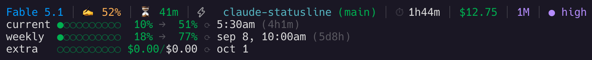

# claude-statusline

Claude Code のステータスラインに、利用上限・作業ディレクトリ・git の状態を表示する

[English](./README.md) | 日本語



> [nilbuild/claude-statusline](https://github.com/nilbuild/claude-statusline) の **個人 fork** です。upstream `v1.0.6` をベースにしています。ステータスラインに出るものはすべて下の表に載せ、スクリーンショットと 1 対 1 で対応させています。**fork** と付いた行がこの fork で追加・変更した部分です（出所は [Credits](#credits) を参照）。

## 表示の読み方

### 1 行目 — セッション

| 画面上の表示 | 意味 | 出所 |
|---|---|---|
| `Fable 5.1` | モデルの表示名 | upstream |
| `✍️ 52%` | コンテキストウィンドウの使用率。50% 未満は緑、50 からオレンジ（この画面はその状態）、70 から黄、90 から赤 | upstream |
| `⏳ 41m` | プロンプトキャッシュの残り時間。これを過ぎるとキャッシュ済みのプレフィックスが失効し、次のターンで書き直しになる。緑、15 分未満で黄、5 分未満で赤。`prompt_cache.expires_at` から読む。TTL（`5m` か `1h`）は直近のリクエストが使ったもの | **fork** |
| `⌛ ~85k` *（この画面にはない）* | プロンプトキャッシュが冷えた状態。次のリクエストでおよそこの量のトークンを書き直す（`recache_tokens_if_cold`）。compaction 直後など、Claude Code 側が別のプレフィックスになると分かっているときは数値を出さない | **fork** |
| `⚠ 2` *（この画面にはない）* | このセッションで起きた想定外のキャッシュミス回数（`prompt_cache.misses`）。セッション途中でプレフィックスが壊れた回数で、原因はたいていツール構成・システムプロンプト・モデル・effort の変更。キャッシュ状態の後ろに、1 以上のときだけ出る | **fork** |
| `⚡` | `--dangerously-skip-permissions` で起動したセッション。ディレクトリ名の直前に出る単独の稲妻で、右のほうに出る `⚡ fast` バッジとは別物 | upstream |
| `claude-statusline` | 作業ディレクトリ | upstream |
| `(main)` | ブランチ名と、作業ツリーの変更数。`±` は変更・リネーム・コピー・コンフリクト・種別変更、`+` は追加、`-` は削除、`?` は未追跡で、たとえば `(main 3±,2+,2-,3?)` のように出る。0 件の種別は省くので、この画面のようにクリーンなツリーではブランチ名だけになる | **fork** |
| `⏱ 1h44m` | セッションの経過時間。`cost.total_duration_ms` の実測値なので、resume をまたいでも続きから数える。1 分未満は `Ns`、1 時間未満は `Nm` | **fork** |
| `$12.75` | セッションのコスト（`cost.total_cost_usd`）。Z.ai 経由のセッションでは Anthropic 価格での見積もりにしかならないため非表示 | **fork** |
| `⚡ fast` *（この画面にはない）* | fast mode が有効（`fast_mode`）。ラベル付きの稲妻で、権限スキップの稲妻とは別 | **fork** |
| `🧠 off` *（この画面にはない）* | thinking が無効（`thinking.enabled == false`） | **fork** |
| `1M` | コンテキストが既定の 200k を超えている（`exceeds_200k_tokens`） | **fork** |
| `● high` | effort レベル。`◉ max`、`● xhigh`、`● high`、`◑ medium`、`◔ low`。`effort.level` をその場で読むので、`/effort` での変更や、セッション限定の `max` も反映される。モデルが値を返さないときは設定ファイルの既定値に戻る | **fork** |

### 2〜4 行目 — 利用上限

| 画面上の表示 | 意味 | 出所 |
|---|---|---|
| `current` / `weekly` | 5 時間枠と週間枠 | upstream |
| `●○○○○○○○○○  10%` / `18%` | 10 マスのバーと使用率。色はコンテキスト使用率と同じ段階で、この程度なら緑、70 から黄、90 から赤 | upstream |
| `→  51%` / `→  77%` | 今のペースが続いた場合の、枠終了時点の着地予測。80 未満は緑、80 からオレンジ、90 から黄、100 から赤 | **fork** |
| `⟳ 5:30am` / `⟳ sep 8, 10:00am` | 枠がリセットされる時刻 | upstream |
| `(4h1m)` / `(5d8h)` | リセットまでの残り時間。1 日以上は `NdNh`、1 時間以上は `NhNm`、それ未満は `Nm` | **fork** |
| `extra   ○○○○○○○○○○ $0.00/$0.00 ⟳ oct 1` | 従量課金（extra usage）の使用額と月間上限。アカウントで `extra_usage` が有効なときだけ出る。この画面では有効だがまだ使っていない | upstream |

Z.ai 経由のセッションでは、各バーの予測とリセット時刻の間に生のクレジット数（`5.4k/12k`）も出ます — **fork**。

着地予測は枠の序盤ではあえて出しません。外挿に意味が出るまで、5 時間枠なら 3 分、週間枠なら 2 時間の経過を待ちます。また、リセット時刻から逆算した経過時間が枠の長さを超える場合（キャッシュが古い）は、死んだデータから描画せず、予測そのものを消します。

## 内部の挙動

- 利用上限は、Claude Code が渡してくればステータスラインの payload から読み、なければ Anthropic の OAuth usage API から取得します。取得は 1 分に 1 回までで、失敗したときは最後にキャッシュした応答を使い回します。ここまでは upstream の挙動で、この fork ではキャッシュの書き込みを atomic にし、同時に読む側が書きかけのファイルを見ないようにしています
- 5 時間枠と週間枠は、payload からも API からも別々に読みます。プランによっては週間枠しか返ってこないためです。返ってこない枠は 0% と表示せず、行ごと省きます。API の取得が失敗したとき（HTTP 429 など）はキャッシュの横に記録を残し、それから 5 分間はどのセッションも API を呼びません。描画のたびに再試行することはありません — **fork**
- **Z.ai（GLM）セッション** — `ANTHROPIC_BASE_URL` のホストが `z.ai` かそのサブドメインのとき、両方の枠を Z.ai の monitor API から読みます。トークンはセッション自身が使っているものを流用し、キャッシュも同じ 1 分間隔です。ただし古いキャッシュを使い続けるのは 10 分までで、それを過ぎると上限の行を最新のふりをして出すのではなく消します。USD コストと Anthropic 専用の `extra` 行は非表示、トークンのないセッションでは別アカウントのキャッシュを出すのではなく上限自体を出しません — **fork**
- 認証情報は env のトークン → プロファイルの認証ディレクトリの `.credentials.json` → macOS キーチェーン → secret-tool の順に解決します。認証ディレクトリは `$CLAUDE_CONFIG_DIR`、ただし `CLAUDE_SECURESTORAGE_CONFIG_DIR` があればそちら（空なら `~/.claude`）で、キーチェーンも Claude Code が使うのと同じ名前（`Claude Code-credentials-<ディレクトリのハッシュ>`）で引き、既定アカウントの項目へは fallback しないので、プロファイルのセッションに別アカウントの上限が出ることはありません — **fork**
- キャッシュは `XDG_CACHE_HOME`（既定 `~/.cache/claude-statusline`）の下に `0700` で置き、プロファイル**と**アカウントの両方で名前空間を分けます。別のプロファイルやトークンで開いたウィンドウ同士が互いの上限を読むことはありません — **fork**
- 認証ヘッダーは argv ではなく stdin（`-H @-`）で curl に渡すので、トークンが `ps` の出力に現れません — **fork**

## インストール

リポジトリを clone してデプロイスクリプトを実行します。構文チェックのあと、`bin/statusline.sh` を `$CLAUDE_CONFIG_DIR/statusline.sh`（既定 `~/.claude/statusline.sh`）にコピーします。

```bash
git clone https://github.com/orbitof/claude-statusline.git
cd claude-statusline
./scripts/deploy-local.sh
```

次に、設定ファイル（`~/.claude/settings.json`、カスタムプロファイルなら `$CLAUDE_CONFIG_DIR/settings.json`）でスクリプトを指定します。下のコマンドはどちらの場所も解決するので、複数プロファイル構成でも同じ記述で動きます。

```json
{
  "statusLine": {
    "type": "command",
    "command": "bash \"${CLAUDE_CONFIG_DIR:-$HOME/.claude}/statusline.sh\"",
    "refreshInterval": 60
  }
}
```

`refreshInterval`（秒）を付けると、Claude Code がタイマーでもスクリプトを再実行します。これがないと、再描画は会話が動いたときと、プロンプトキャッシュが失効した瞬間の 1 回だけです。`⏳` のカウントダウンもリセットまでの残り時間も、最後のターンが報告した値のまま止まって見えます。

upstream の更新を取り込んで再デプロイするには:

```bash
git fetch upstream && git rebase upstream/main
git push --force-with-lease origin main
./scripts/deploy-local.sh
```

> **オリジナル**のほうを使いたい場合は [nilbuild/claude-statusline](https://github.com/nilbuild/claude-statusline) から npm でインストールできます: `npx @kamranahmedse/claude-statusline`

## 必要なもの

- [jq](https://jqlang.github.io/jq/) — JSON の解析
- curl — 利用上限データの取得（フォールバック用。最近の Claude Code は stdin で上限を渡してくる）
- git — ブランチ情報

macOS では:

```bash
brew install jq
```

## アンインストール

`~/.claude/settings.json` から `statusLine` の項目を消し、以前の `statusline.sh` をバックアップしてあれば戻します。

## Credits

Kamran Ahmed 氏の [nilbuild/claude-statusline](https://github.com/nilbuild/claude-statusline) の fork です。

いくつかの機能は upstream の他の fork から移植しました（実装はここで書き直していますが、設計のクレジットは各 fork にあります）。

- **着地予測** — [peterdrier](https://github.com/peterdrier/claude-statusline) 氏の fork の設計（予測の計算式、`→NNN%` の書式、999 の上限、ペースの色分け）
- **payload バッジ / 実測のセッションタイマー** — [noah4520](https://github.com/noah4520/claude-statusline) 氏の fork（`fast_mode`、`thinking.enabled`、`exceeds_200k_tokens`、`cost.total_duration_ms`）
- **git の変更数** — [camkeith](https://github.com/camkeith/claude-statusline) 氏の fork（種別ごとの件数。`±/+/-/?` の記号はこの fork の変種）
- **`CLAUDE_CONFIG_DIR` 対応** — [mhmzdev](https://github.com/mhmzdev/claude-statusline) 氏の fork（upstream PR #34 を参照）
- **stdin 経由のトークン渡しと非公開キャッシュディレクトリ** — [kay404](https://github.com/kay404/claude-statusline) 氏の fork（upstream PR #30 を参照）

## License

MIT
