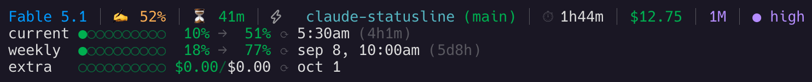

# claude-statusline

Configure your Claude Code statusline to show limits, directory and git info



> **Personal fork** of [nilbuild/claude-statusline](https://github.com/nilbuild/claude-statusline),
> based on upstream `v1.0.6` with these additions:
>
> - **Session cost** — a `$x.xx` segment on line 1, read from `cost.total_cost_usd`.
> - **Live session effort** — reads `effort.level` from the statusline payload, so
>   per-session `/effort` / `--effort` (including the session-only `max` level, which
>   is never written to `settings.json`) is reflected, not just the persisted default.
> - **GLM (Z.ai) backend support** — when Claude Code runs against Z.ai's
>   Anthropic-compatible endpoint (GLM Coding Plan, detected via the
>   `ANTHROPIC_BASE_URL` host being `z.ai` or a subdomain), the `current` /
>   `weekly` quota lines are read from Z.ai's monitor API instead of
>   Anthropic's, showing credit usage and reset times. The synthetic USD cost
>   estimate and the Anthropic-only `extra` line are hidden in that mode.
>   Requires `ANTHROPIC_AUTH_TOKEN` (or `ANTHROPIC_API_KEY`) in the
>   environment, which any Z.ai-backed session already sets.
> - **Pace projection** — a `→NNN%` marker after each rate line: where the
>   window-end usage lands if the pace so far holds. Works for both the
>   5-hour and weekly windows (reset time is the only input), including
>   Z.ai-backed windows. Suppressed while a window is too young for a
>   meaningful pace.
> - **Payload badges** — `⚡ fast` (fast mode on), `🧠 off` (thinking disabled),
>   and a magenta `1M` badge when the model exceeds the 200k default context.
>   The session timer reads `cost.total_duration_ms` (measured wall clock,
>   survives resumes) instead of `session.start_time`.
> - **Git change counts** — the dirty marker expands from `*` to per-kind
>   counts such as `3±,1+,2-` (modified, added, deleted; untracked shows as `?`).
> - **`CLAUDE_CONFIG_DIR`** — settings and credentials are read from
>   `$CLAUDE_CONFIG_DIR` when set, for multi-profile setups.
> - **Hardened fetches** — auth tokens are piped to curl via stdin (never
>   visible in `ps` as command-line arguments), and usage caches live under
>   `XDG_CACHE_HOME` (default `~/.cache/claude-statusline`) with `0700`
>   permissions instead of world-readable `/tmp`.
>
> This fork is **not published to npm**. Install it from source (below). The upstream
> `npx` command installs the original version *without* these changes.

## Install

Clone the repo and run the deploy script. It runs a syntax check, then copies
`bin/statusline.sh` to `$CLAUDE_CONFIG_DIR/statusline.sh` (default `~/.claude/statusline.sh`):

```bash
git clone https://github.com/orbitof/claude-statusline.git
cd claude-statusline
./scripts/deploy-local.sh
```

Then point Claude Code at the script in your settings file (`~/.claude/settings.json`,
or `$CLAUDE_CONFIG_DIR/settings.json` for a custom profile). The command below
resolves either location, so the same snippet works for multi-profile setups:

```json
{
  "statusLine": {
    "type": "command",
    "command": "bash \"${CLAUDE_CONFIG_DIR:-$HOME/.claude}/statusline.sh\""
  }
}
```

To pull in later upstream changes and redeploy:

```bash
git fetch upstream && git rebase upstream/main
git push --force-with-lease origin main
./scripts/deploy-local.sh
```

> Prefer the **original** version instead? Install it via npm from
> [nilbuild/claude-statusline](https://github.com/nilbuild/claude-statusline):
> `npx @kamranahmedse/claude-statusline`.

## Requirements

- [jq](https://jqlang.github.io/jq/) — for parsing JSON
- curl — fallback fetch of rate-limit data (recent Claude Code passes rate limits on stdin)
- git — for branch info

On macOS:

```bash
brew install jq
```

## Uninstall

Remove the `statusLine` entry from `~/.claude/settings.json`, and restore your
previous `statusline.sh` if you kept a backup.

## Credits

Fork of [nilbuild/claude-statusline](https://github.com/nilbuild/claude-statusline)
by Kamran Ahmed.

## License

MIT
